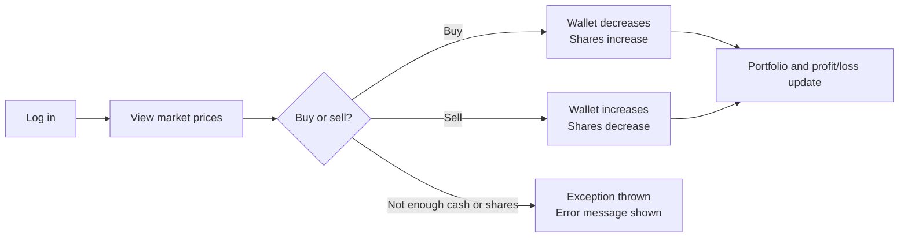
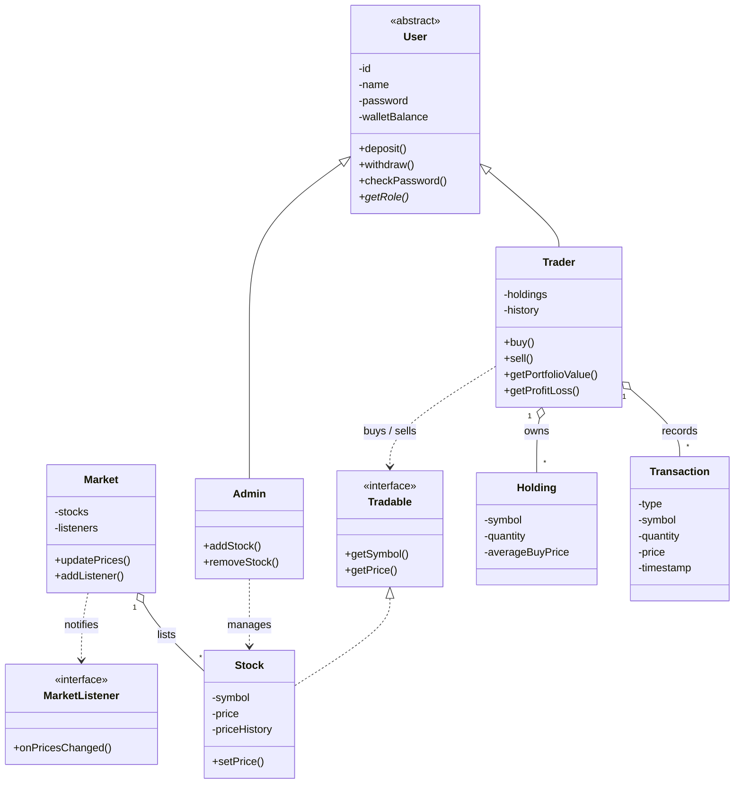
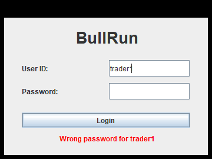
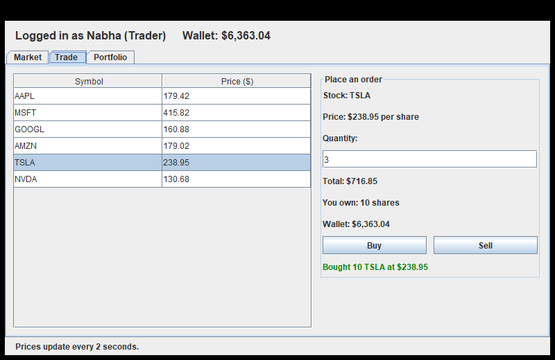
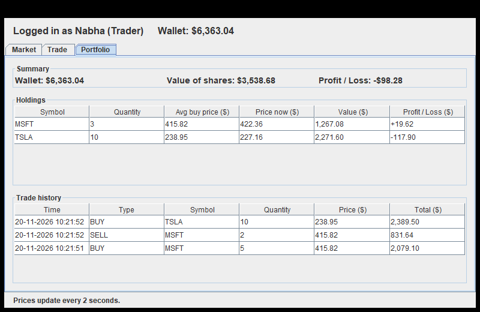

# 🐂 BullRun
### Virtual Stock Trading and Portfolio Simulator

Practice trading stocks with virtual money. Learn how the market works without risking real money.


**Team TLE:** Adwait Misra · Muhammad Owais Husain Puthuveetil · Kaviish Agrawal · Nabha Birjerane

---

## What is BullRun?

BullRun is a Java application that simulates a small stock market.

- Every trader starts with a **wallet** of virtual cash.
- Stock prices **change over time**.
- Traders **buy and sell** shares and track their profit or loss.
- An **admin** decides which stocks are listed on the market.

## How a trade works



## Project design



| Class | Role |
|---|---|
| `User` | Abstract parent for anyone who logs in: name, password and wallet |
| `Trader` | Extends `User`. Buys and sells stocks and owns holdings |
| `Admin` | Extends `User`. Adds or removes stocks from the market |
| `Tradable` | Interface for anything with a symbol and a price |
| `Stock` | Implements `Tradable`. Keeps its price history |
| `Market` | Holds all stocks and moves their prices randomly on each update |
| `MarketListener` | Interface for anything that wants to hear about price changes |
| `UserRegistry` | Stores all users and checks logins |
| `Holding` | A position, such as "5 shares of AAPL at an average of 100" |
| `Transaction` | One history entry, such as "BUY 10 AAPL @ 100 at 12:30" |
| `LoginFrame` | Login window with ID and password fields |
| `MainFrame` | Main window with tabs (Market, Trade, Portfolio) and a header showing the wallet |
| `TradePanel` | Trade tab: pick a stock, enter a quantity, press Buy or Sell |
| `PortfolioPanel` | Portfolio tab: wallet, value of shares, profit/loss, holdings and trade history |
| `InsufficientFundsException` | Thrown when a buy costs more than the wallet holds |
| `InsufficientSharesException` | Thrown when a sale exceeds the shares owned |
| `InvalidQuantityException` | Thrown when a quantity is zero, negative or more than we have |
| `UserNotFoundException` | Thrown at login when the ID does not exist |
| `WrongPasswordException` | Thrown at login when the password is wrong |

## OOP concepts used

| Concept | Where |
|---|---|
| Abstract class | `User`, with the abstract method `getRole()` |
| Inheritance | `Trader` and `Admin` extend `User` |
| Polymorphism | A `User` variable can hold a `Trader` or an `Admin` |
| Interface | `Tradable` (implemented by `Stock`) and `MarketListener` |
| Observer pattern | `Market` notifies its `MarketListener`s when prices change |
| Anonymous classes | The button and timer listeners in the `gui` package |
| GUI and event handling | Swing windows, `JTable`, `JTabbedPane`, layout managers, `ActionListener`, `KeyAdapter`, `Timer` |
| Iterator | Removing a stock safely in `Market` and `Admin` |
| Encapsulation | Private fields with getters, such as `walletBalance` and the final fields of `Transaction` |
| Method overriding | `getRole()` and `toString()` |
| Custom exceptions | The `exceptions` package |
| Exception handling | `try` / `catch` in `LoginFrame`, `TradePanel` and `ConsoleDemo` |
| Collections | `ArrayList` for stocks, holdings and transactions |
| Packages | `gui`, `model` and `exceptions` |
| Constructors, `this`, `super` | All model classes |

## Roadmap

- [x] Core classes: `User`, `Trader`, `Admin`, `Stock`, `Holding`
- [x] Custom exceptions for invalid trades
- [x] `Transaction` class and per-trader trade history
- [x] `Market` class with random price movement and Observer notifications
- [x] Login window
- [x] Market tab with live prices (Swing `Timer`)
- [x] Trade tab and Portfolio tab for traders
- [x] Input validation (invalid quantity exception)
- [ ] Admin tab (add and remove stocks)
- [ ] Live price chart
- [ ] Save and load users, holdings and transactions
- [ ] Report and demo

## Getting started

Requires **JDK 21 or newer**.

```bash
git clone https://github.com/nabha3/tradingsimulation.git
cd tradingsimulation
javac -d bin src/*.java src/gui/*.java src/model/*.java src/exceptions/*.java
java -cp bin App            # opens the login window
java -cp bin ConsoleDemo    # optional: the text-only demo
```

Demo accounts:

| Role | ID | Password |
|---|---|---|
| Trader | `trader1` | `pass123` |
| Admin | `admin` | `admin123` |

The market lists global stocks (AAPL, MSFT, GOOGL, AMZN, TSLA, NVDA). Prices are in US dollars, start from made-up values and then move randomly every 2 seconds.

## Screenshots

| Login | Market |
|---|---|
|  |  |

| Trade | Portfolio |
|---|---|
|  |  |

## Console demo output

`ConsoleDemo` is a text-only version that shows buying, selling, exceptions and price updates (timestamps and prices will differ):

```text
Trader Nabha (wallet 10000.00)
After buying 10 AAPL: Trader Nabha (wallet 9000.00)
After selling 5 AAPL: Trader Nabha (wallet 9500.00)
[AAPL: 5 shares, avg 100.00]
AAPL now AAPL @ 120.00, P/L = 100.0
Portfolio value = 600.0
Caught: Not enough money: need 120000.00 but wallet has 9500.00
Caught: Not enough shares of AAPL: you own 5 but tried to sell 99
Caught: Quantity must be at least 1.
--- Market ---
Prices changed: [AAPL @ 100.64, MSFT @ 51.42]
Prices changed: [AAPL @ 104.56, MSFT @ 52.96]
Prices changed: [AAPL @ 105.77, MSFT @ 53.34]
--- History ---
20-11-2026 10:22:08  BUY 10 AAPL @ 100.00 (total 1000.00)
20-11-2026 10:22:08  SELL 5 AAPL @ 100.00 (total 500.00)
Trader -> Trader Nabha (wallet 9500.00)
Admin -> Admin Boss (wallet 0.00)
```

## Project structure

```text
tradingsimulation/
├── src/
│   ├── App.java                 # starts the GUI
│   ├── ConsoleDemo.java         # text-only demo
│   ├── gui/
│   │   ├── LoginFrame.java
│   │   ├── MainFrame.java
│   │   ├── TradePanel.java
│   │   └── PortfolioPanel.java
│   ├── model/
│   │   ├── User.java
│   │   ├── Trader.java
│   │   ├── Admin.java
│   │   ├── Stock.java
│   │   ├── Holding.java
│   │   ├── Market.java
│   │   ├── MarketListener.java
│   │   ├── Transaction.java
│   │   ├── UserRegistry.java
│   │   └── Tradable.java
│   └── exceptions/
│       ├── InsufficientFundsException.java
│       ├── InsufficientSharesException.java
│       ├── InvalidQuantityException.java
│       ├── UserNotFoundException.java
│       └── WrongPasswordException.java
├── docs/                        # screenshots
└── README.md
```

*Educational project. Not financial advice, and no real money is involved.*
